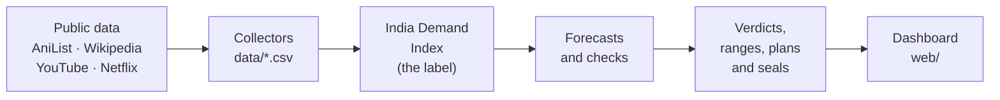

<div align="center">


# Yosoku 予測

### Will this anime land in India?
A launch verdict for every title, with the evidence behind it, before the licensing decision is made.

Thapar Japan Hackathon · GEEK-PS-01 · Team shecodes

[](https://github.com/Ajha2005/yosoku/actions/workflows/tests.yml)

[](LICENSE)

[**Demo video**](docs/Yosoku_shecodes_demo.mp4) · [**Pitch deck**](docs/Yosoku_shecodes_deck.pdf) · [**Quick start**](#quick-start) · [**How it works**](#how-it-works) · [**Results**](#results-at-a-glance) · [**Docs**](#documentation)

</div>

---

## The problem

Streaming platforms, Japanese licensors, cinema chains and dubbing studios decide every season which anime to bring to
India, when to commit and which language to dub first. The sums are in crores, and before launch there is little
India-specific evidence to go on.

## What Yosoku does

Yosoku turns public data into an **India Demand Index** (a 0–100 score for how much India watched, discussed and read
about a title in its first 28 days), forecasts that score at three moments around the Japanese premiere, and turns each
forecast into a verdict:

- **Launch**: the low end of the 80% range clears the launch line, so commit.
- **Test-market**: the range straddles the lines, so license small and decide again when buzz arrives.
- **Hold**: the high end sits under the hold line, so wait.

Every verdict comes with its range, a launch plan and the evidence it rests on.

| A rights holder asks | Yosoku answers | Where |
| --- | --- | --- |
| Should we sell this title's India rights? | Launch, Test-market or Hold, with an 80% range and a launch plan | every forecast sheet |
| Can we trust the numbers? | Forecasts for unreleased titles are sealed with a SHA-256 fingerprint before they air and graded after | Forecasts → Upcoming, [`predictions/sealed/`](predictions/sealed/LEDGER.md) |
| When do we know enough to decide? | The decision clock: little changes before the premiere, most in its first days | Track record |
| How likely is a hit? | From T+7 (and day 3 in the daily forecasts), the chance of a top-third result; 94% of its calls of 70% or more came true | forecast sheets at T+7 |
| Which dub language, if any? | Dub demand and the language hubs of Indian fans' comments, read in Hinglish too | forecast sheets |
| What is India asking for? | Indian comments asking for a dub or for where to watch, title by title: 1,197 on 68 titles | Demand guide |
| Where else will it travel? | The countries whose Netflix Top 10 similar titles reached beyond Japan, across 88 countries | forecast sheets, Demand guide |
| How do we get it approved? | A one-page 稟議書 in Japanese: conclusion, grounds, precedents, risks, next decision dates, approval boxes | the 稟 button on every sheet |
| What is it worth in yen? | A yen range for every forecast, once a partner shares what 30 or more past titles earned in India | `python -m yosoku.money` (private) |

## How it works



**The label.** The India Demand Index blends three parts, each a percentile rank against a frozen pool of 1,400 titles: YouTube
trailer comments from India (50%), streaming (Netflix India's Top 10, 33%) and Wikipedia pageviews (17%). A title needs
two parts to be labelled, and the ranking pool is frozen (`labels/reference_v1.csv`), so collecting new titles never
moves an existing label. Indian comments are found with a word list that reads Hinglish and with AI4Bharat's IndicLID.

**Three forecast moments.** Days are counted from the Japanese premiere (day 0). The index measures days 0 to 27.

| Moment | Made | What it sees |
| --- | --- | --- |
| **Cold** | any time before launch | metadata only: genre, format, source, audience, the closest past titles, the prequel's index |
| **T−28** | 28 days before the premiere | adds buzz from days −56 to −29 |
| **T+7** | 7 days after the premiere | adds days −28 to −1 and launch week (days 0 to 6); a nowcast, since those days sit inside the 28 measured |

The **Blend** is the main model at every moment. Simple rules (genre average, sequel carry-over, India YouTube alone,
global Wikipedia) are the baselines it must beat, and where it does not, the rule makes the forecasts and the report
says so. The **decision clock** refits the Blend for every day from −49 to +14, and the daily job uses it to forecast
every title still in play. Nothing is trained on the future: a test checks that no input uses data from after its
forecast moment.

| Step | Module | Writes |
| --- | --- | --- |
| Label | `yosoku/labels.py` | `labels/label_v1.csv`, `reports/label.md` (agreement, stability and box-office checks) |
| Evaluate | `yosoku/evaluate.py` | `reports/evaluation.md` / `.json`: models against baselines on 2024 |
| Ablation | `yosoku/ablation.py` | `reports/ablation.md` / `.json`: what each signal is worth |
| Clock | `yosoku/clock.py` | `reports/clock.md` / `.json`: a forecast made on each day, scored |
| Decide | `yosoku/decision.py` | `predictions/predictions.json`, `reports/decision.md`: verdicts, ranges, plans |
| Daily | `yosoku/daily.py` | `predictions/history.csv`, `reports/alerts.md`: titles in play, every day |
| Seal | `yosoku/seal.py` | `predictions/sealed/`: forecasts frozen before titles air, with fingerprints |
| Export | `yosoku/export_web.py`, `yosoku/guide.py` | `web/data/`: the site's data and the Demand guide |

The split is by Japanese start date: train 2019–2023, validate 2024, test 2025. The 2025 titles are scored once, at the
very end (`python -m yosoku.run --final`). Reasoning behind every choice is in [`docs/decisions.md`](docs/decisions.md),
and every module is described in the [operations guide](docs/operations.md#from-data-to-forecasts).

## Results at a glance

On the **52 titles of 2024**, which the models never trained on:

| Moment | Forecast made by | Rank correlation with the real index (95% interval) | Verdicts: Launch / Test-market / Hold |
| --- | --- | --- | --- |
| Cold | genre average (the model does not beat it here) | 0.12 (−0.13 to 0.37) | 0 / 52 / 0 |
| T−28 | Blend | 0.23 (−0.08 to 0.49) | 4 / 48 / 0 |
| T+7 | Blend | **0.66** (0.47 to 0.80) | 11 / 40 / 1 |

- **Launch calls held up.** At T−28, 4 of 4 titles called Launch ended in the top third of real India demand; at T+7, 10
  of 11. Chance alone puts a title there one time in three. The verdict lines were tuned on these same titles, so these
  rates are optimistic: the sealed forecasts and the 2025 test are the honest checks.
- **The decision clock.** Over 20 rolling seasons, rank correlation improves little before the premiere (0.29 seven weeks
  out, 0.38 one week out), then jumps (0.41 at the premiere, 0.53 on day 3). So: license small and early, decide the dub
  on day 3 to 7.
- **A chance of a hit.** From T+7, the chance of a top-third result beats the base rate (Brier skill 0.19),
  and 94% of its 17 calls of 70% or more came true.
- **Sealed ahead of time.** 50 forecasts for Winter 2027 titles were sealed on 24 October 2026, before any of them aired.

### Honest limits

We would rather show these than have you find them:

- **Cold forecasts are near chance.** Before any buzz the ranges are too wide to separate titles, so every title is
  Test-market there, which is itself the advice. The model loses to the genre average on 2024 alone (gate G4).
- **T+7 is a nowcast.** Its inputs sit inside the 28 days it measures. The value is the rule it supports: wait until
  day 3 to 7 before committing.
- **The 80% ranges held for 63–67% of 2024 titles** (target 70–90%): 79–85% of titles without YouTube data, but only
  37–47% of the 19 with it, because YouTube was collected for the 200 titles most popular today, which are mostly hits.
  Ranges for upcoming titles are set from those titles' misses, and are wider.
- **The index checks fail narrowly (gate G2).** All three parts agree positively, but lowering the Wikipedia weight by 0.10
  still reshuffles the ranking (Kendall's tau 0.70, target 0.9). The box-office check covers only 6 films.
- **No Google Trends this round.** The index is YouTube, streaming and Wikipedia only. YouTube covers the top 200
  titles; upcoming titles have none yet (the API key was rejected), so they get cold forecasts only.

The files in [`reports/`](reports/) are generated and are the source of truth if any number here drifts.

<details>
<summary><b>Full status notes, as of 24 October 2026</b></summary>

As of 24 October 2026. The files in `reports/` are generated and are the source of truth if these lines drift.

- **Data:** 1,400 titles, the 50 most popular Japanese anime of every season from 2019 to 2025. The 200 most popular
  also have YouTube trailer comments (trailer search only, `--no-hindi`). The collected CSVs are committed in `data/`
  (the Reddit files are not), so the model and the site run without any API key (see [Quick start](#quick-start)).
  The comments are also kept as per-day counts without text (`data/youtube_comment_daily.csv`, and the comments asking
  for a dub or for where to watch in `data/youtube_ask_daily.csv`), and the pipeline runs from those alone, so the comment text
  itself is not in the repo (see [Responsible data use](#responsible-data-use)). Netflix's Top 10 is kept for India
  (`netflix_matches.csv`, part of the index) and for every other country (`netflix_countries.csv`: 160 titles reached
  a Top 10 in 88 countries within six months of their Japanese start; India comes joint 36th, with 13 titles).
- **No Google Trends this round**, so the India Demand Index is YouTube 50%, Streaming 33%, Wikipedia 17%.
  319 titles have at least two parts and get a label. The ranking pool is frozen (`labels/reference_v1.csv`), so
  collecting new titles never moves an existing label. `docs/decisions.md` has the change log.
- **Label checks (gate G2): fail, narrowly.** All three pairs of parts now agree positively (YouTube and Netflix 0.50,
  the Wikipedia pairs about 0.14), but lowering the Wikipedia weight by 0.10 still moves the ranking (Kendall's tau 0.70,
  target 0.9). The box-office check covers only 6 films (rank correlation 0.43, interval −0.60 to 1.00).
- **Forecast checks (gate G4): fail at Cold only.** On the 52 labelled 2024 titles the Blend beats every simple rule at
  T−28 (rank correlation 0.23) and T+7 (0.66, interval 0.47 to 0.80). At Cold it ranks the 20 rolling seasons at 0.18
  against the genre average's 0.09, but loses on 2024 alone (0.05 against 0.12), and the rule picks on 2024, so the
  genre average makes the cold forecasts. T+7 is a nowcast: its inputs sit inside the 28 days it measures.
- **The decision clock** (Track record tab, `reports/clock.md`) scores a forecast made on each day: over 20 seasons
  it improves little from day −49 (0.29) to day −7 (0.38), then jumps between the premiere (0.41) and day +3 (0.53).
- **Verdicts:** the cold ranges are too wide to separate titles, so every title is Test-market there. On the 2024
  split, T−28 gives 4 Launch and 48 Test-market; T+7 gives 11 Launch, 40 Test-market, 1 Hold.
- **What the site shows:** 50 upcoming Winter 2027 titles (cold forecasts, sealed on 24 October 2026; 39 have no
  announced start date yet) and the 2024 backtest, 52 titles. The 2025 test titles are unscored: that happens once, at the very end.
- **80% ranges:** on 2024 they held for 63–67% of titles (target 70–90%): 79–85% of the titles whose index has no
  YouTube part, 37–47% of the 19 that have one, because YouTube was collected for the titles most popular today.
  Upcoming titles, which all get YouTube data, take wider ranges set from those titles' misses.
- **Wikipedia articles written after launch** were swapped for the page readers used then (`fallback` rows in
  `data/wiki_articles_fixes.csv`), so the biggest shows now have a Wikipedia part.
- **YouTube for upcoming titles** is not collected yet (the API key was rejected), so they have cold forecasts only.
  With a key, the 103 trailers whose comments were cut at 1,000 should also be collected in full (one day of quota).
- **The most promising next input** is AniList's dated list counts (users with a title on their list, day by day
  before the premiere): forecasts made 90 days out rise from 0.18 to 0.24 over the 20 rolling seasons. Not adopted
  yet: it needs a collector and AniList's commercial terms (`docs/roadmap.md`, section 3).
- **What to build next** is in `docs/roadmap.md`: a review of the model, how the project scales as data arrives
  every day, what would make Japanese rights holders buy it, and the licences to check before selling it.

</details>

### Check our sealed forecasts

The 50 Winter 2027 forecasts are in [`predictions/sealed/`](predictions/sealed/). A seal is never rewritten: its
SHA-256 fingerprint sits in the public [ledger](predictions/sealed/LEDGER.md), dated by the commit that added it.

```
python -m yosoku.seal --verify     # every sealed file still matches its ledger fingerprint
python -m yosoku.seal --score      # after the titles air and are labelled: how the sealed forecasts did
```

Without Python, `sha256sum predictions/sealed/2026-10-24-winter2027.json` (on Windows,
`certutil -hashfile <file> SHA256`) must print the fingerprint in the ledger.

> **A note on commit hashes.** On 25 October 2026 the repository's commit history was rewritten once, to credit the team
> as the authors of every commit. File contents, dates and trees are unchanged, so the fingerprints still verify, but
> commit hashes changed. The sealed file and ledger record the model commit as `9d28896`; that commit is now `3872758`.

## The dashboard

`web/` is a static site (HTML, CSS and JavaScript, no server and no build step) that Vercel can host as it is.

| Tab | What it shows |
| --- | --- |
| **Overview** | the poster wall and the headline numbers |
| **Forecasts** | a verdict card for every title; each sheet has the forecast and range, the launch plan, what moves the forecast, its path day by day, the closest past titles, where else it could travel, the India language-hub map, dub demand and the release-window what-if. It prints as a one-page brief in English, or as a Japanese 稟議書 |
| **Track record** | the 2024 backtest against simple rules, how often the ranges held and why, and the decision clock |
| **Method** | how a forecast becomes a verdict, the index checks, what each signal is worth, and where the data comes from and can mislead |
| **Demand guide** | what India has watched, what kind of title gets there, where in India, what India is asking for, beyond India, and a check-your-title tool |

The business story (what following the calls would have been worth, who pays, expansion, why us) is told in the final
presentation rather than on the site: see the [pitch deck](docs/Yosoku_shecodes_deck.pdf) and
[`docs/demo.md`](docs/demo.md), which also has a 3-minute walk-through and prepared answers.

## Quick start

No API key and no data collection needed: the collected CSVs are committed. You need
[Python 3.10 or newer](https://www.python.org/downloads/) (on Windows, tick **Add python.exe to PATH**).

```bash
git clone https://github.com/Ajha2005/yosoku.git
cd yosoku

python3 -m venv .venv
source .venv/bin/activate              # Windows: py -m venv .venv, then .venv\Scripts\activate
pip install -r requirements.txt

python -m yosoku.run                   # label, evaluation, decision clock and verdicts (about 2 minutes)
python -m yosoku.export_web --no-covers   # copies the forecasts to web/data/ and builds the Demand guide
python -m http.server -d web 8000      # the dashboard, at http://localhost:8000
python -m pytest tests                 # the test suite (about 2 minutes)
```

`yosoku.run` rewrites `labels/`, `reports/` and `predictions/` with the committed numbers; on a different version of
numpy or scikit-learn the last digit of some floats can differ. A few scipy "constant input" warnings are normal: some
baselines predict the same value for every title. Leave out `--no-covers` to fetch cover art from AniList (the site
links to AniList's image servers rather than copying the images).

GitHub Actions runs the tests, and checks that every site script parses and every JSON file loads, on every push and
pull request ([`.github/workflows/tests.yml`](.github/workflows/tests.yml)).

To put the site online, import the repo on [vercel.com/new](https://vercel.com/new), set **Root Directory** to `web`,
leave the framework as **Other** and deploy. The steps are in the
[operations guide](docs/operations.md#the-website-static-for-vercel).

## Collect your own data

Optional: the committed CSVs are enough to run everything. Each collector reads a public source and writes into `data/`;
`merge.py` ends in `data/dataset.csv`, one row per title.

| Step | Script | Source | Needs |
| --- | --- | --- | --- |
| 1 | `collect_titles.py` | AniList | nothing (run first) |
| 2 | `collect_wikipedia.py` | Wikidata and Wikipedia pageviews | nothing |
| 3 | `collect_netflix.py` | Netflix Top 10 (about 94 countries) | nothing |
| 4 | `collect_youtube.py` | YouTube Data API | a free API key |
| 4b | `detect_languages.py` | IndicLID on the trailer comments | `pip install fasttext` (optional) |
| 5, 5b | `collect_trends.py`, `collect_reddit.py` | Google Trends, Reddit via Arctic Shift | optional; not collected this round |
| 6 | `merge.py` | the files above | nothing |

Copy `.env.example` to `.env` and fill it in (`.env` is git-ignored: never commit it or paste it in chat).
`YOSOKU_CONTACT` is an email or URL that Wikipedia can reach you on; `YOUTUBE_API_KEY` is only for step 4.

<details>
<summary><b>Getting a YouTube API key (free, about 5 minutes)</b></summary>

1. Open [console.cloud.google.com](https://console.cloud.google.com/), sign in and create a project (for example "yosoku").
2. **APIs & Services → Library**, search **YouTube Data API v3**, click **Enable**.
3. **APIs & Services → Credentials → Create credentials → API key**.
4. Put it in `.env` as `YOUTUBE_API_KEY=...`. Restricting the key to the YouTube Data API v3 is a good idea.

Each key gets 10,000 quota units a day, so teammates with a key each collect faster: see
[sharing the YouTube work](docs/operations.md#sharing-the-youtube-work-between-three-keys).

</details>

Everything else, in the [operations guide](docs/operations.md): running the collectors, choosing titles, forecasting
unreleased titles and sealing them, the daily job, other markets (Indonesia, Thailand, Brazil and Mexico are set up),
what to check by hand, and the traps in the data.

## Repository layout

```
collectors/    data collectors for AniList, Wikipedia, Netflix, YouTube, Trends and Reddit, plus merge.py
yosoku/        the model pipeline (labels to verdicts), the daily job, sealing, and the site export
data/          collected CSVs; data/upcoming/ holds unreleased titles; data/partner/ stays private
labels/        the India Demand Index of every labelled title, and the frozen ranking pool
predictions/   forecasts and verdicts, the daily forecast log, and the sealed forecasts
reports/       generated reports (fix the code, not the report)
web/           the dashboard: a static site for Vercel; web/data/ is written by yosoku.export_web
docs/          operations guide, decisions, roadmap, demo script, pitch deck and demo video
tests/         pipeline, collector and site-export tests on fake data and a fake YouTube API
tools/         one-off generators (the India map outlines)
.github/       CI: tests, and site syntax checks, on every push and pull request
```

`data/raw/` (the API cache) and `.env` (your keys) are git-ignored.

## Responsible data use

- **Public data only:** official APIs where they exist (AniList, Wikimedia, YouTube) and Netflix's published weekly file.
  No usernames are stored. Google Trends has no open API, so `pytrends-modern` reads the public website and goes slowly
  on purpose. Reddit posts come from the public [Arctic Shift](https://github.com/ArthurHeitmann/arctic_shift) archive,
  not from reddit.com, and only a post's title, date, score, comment count and flair are kept.
- **No comment text in the repo.** Comments are kept as per-day counts with no text (`data/youtube_comment_daily.csv`,
  `data/youtube_ask_daily.csv`), and the whole pipeline runs from those. The raw text file stays on the laptops that
  collected it and is git-ignored. Language detection runs on your own laptop (a one-off 230 MB model), so no comment
  text is sent anywhere; only its verdict per comment is saved.
- **A partner's figures are confidential.** `data/partner/` is git-ignored except its README and template, the amounts
  fitted on the figures stay in `data/partner/money.json`, and nothing reaches the site without `--with-money`.
- **Before charging anyone,** check the sources' commercial terms: AniList's API is free only below $150 a month of
  revenue and forbids mass collection; YouTube's API policies limit how long API data may be kept (30 days without the
  channel owner's authorisation, which is why the daily view-count log keeps 30 days). Section 7 of
  [`docs/roadmap.md`](docs/roadmap.md) has the details.

## Documentation

| Read | For |
| --- | --- |
| [`docs/operations.md`](docs/operations.md) | collecting data, the daily job, sealing, other markets, deploying, what to check by hand |
| [`docs/decisions.md`](docs/decisions.md) | the six choices that shape the dataset, and the dated change log; read before changing a default |
| [`docs/roadmap.md`](docs/roadmap.md) | a review of the model, scaling with daily data, what Japanese buyers need, licences, the plan |
| [`docs/demo.md`](docs/demo.md) | the 3-minute demo, the business story and prepared answers |
| [`docs/Yosoku_shecodes_deck.pdf`](docs/Yosoku_shecodes_deck.pdf) | the 10-slide pitch deck (editable: [`.pptx`](docs/Yosoku_shecodes_deck.pptx)) |
| [`docs/Yosoku_shecodes_demo.mp4`](docs/Yosoku_shecodes_demo.mp4) | a 2:26 captioned demo video with voice-over |
| [`reports/`](reports/) | the generated evidence: evaluation, ablation, decision clock, verdicts, label checks, alerts |

## License, data and credits

Built by **Team shecodes** for the Thapar Japan Hackathon (problem statement GEEK-PS-01).

The code, documents and site are released under the [MIT License](LICENSE). The data they use comes from third-party
sources, each with its own terms (below), which the MIT License does not change.

Data from [AniList](https://anilist.co), [Wikimedia](https://www.wikimedia.org) (Wikidata and pageviews), the
[YouTube Data API](https://developers.google.com/youtube/v3), [Netflix's Top 10](https://www.netflix.com/tudum/top10)
lists and the [Arctic Shift](https://github.com/ArthurHeitmann/arctic_shift) Reddit archive; Indian-language detection by
AI4Bharat's [IndicLID](https://github.com/AI4Bharat/IndicLID). Check each source's terms before commercial use.
